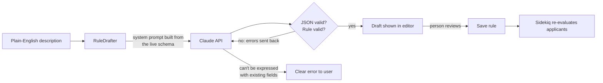
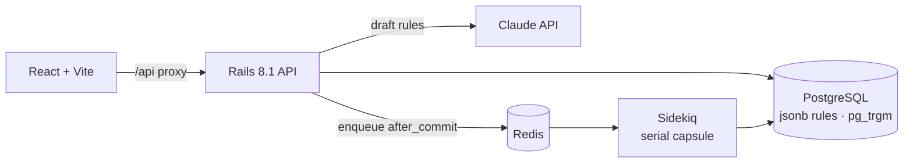

# Rule Builder

**An applicant-screening rule engine with an AI rule author.** Describe a rule in plain English, Claude turns it into a validated rule, a person reviews it, and every applicant is re-evaluated in the background.

Built with **Rails 8.1 (API) · React 19 · PostgreSQL · Sidekiq / Redis · Claude API (Anthropic Ruby SDK)**.

> *"Reject applicants under 18, or anyone with a credit score below 550 unless they earn over 150k"*
>
> ↓ Claude (validated, reviewed, then saved)
>
> `age < 18` **OR** (`credit_score < 550` **AND** `annual_income ≤ 150000`) → **rejected**

---

## Highlights

| Area | What it shows |
|---|---|
| 🤖 **AI rule drafting** | Plain English → structured rule JSON with Claude. Output is checked against the same validations as hand-built rules, with a self-correction loop, a "refuse instead of guess" safety rule, and human review before anything is saved. |
| ⚙️ **Rule engine** | Nested AND/OR condition trees, typed operators, rules applied in priority order (first match wins). |
| 🔎 **Fast search** | PostgreSQL `pg_trgm` trigram GIN indexes for substring search, plus `lower()` prefix indexes for short terms. Each query matches its index exactly. |
| 🧵 **Background jobs** | Sidekiq re-evaluates all applicants when rules change. Rapid edits are merged into one queued run through Redis, runs never overlap, and writes are batched. |
| 🔁 **Idempotent API** | `Idempotency-Key` header support (the Stripe pattern), so a retried POST never creates a duplicate. |
| ✅ **Tested** | 52 tests / 177 assertions. AI tests use a fake client, so CI never calls the paid API. |

---

## 🤖 AI feature: drafting rules from plain English

The **Rules** tab has a "Describe a rule in plain English" box. Claude drafts the rule, and the draft opens in the normal rule editor **unsaved**, so a person checks it before it goes live.



### How it's built ([`app/models/rule_drafter.rb`](app/models/rule_drafter.rb))

- **The prompt comes from the code, so it can't drift.** The system prompt is generated from `Applicant::FIELDS`, `ConditionTree::OPERATORS` and `Rule::OUTCOMES`. Add a field to the model and the AI knows about it, with no prompt edits.
- **Same validation as hand-built rules.** Claude's output goes through `Rule#valid?` and `ConditionTree#errors`. The AI gets no shortcut past the rules a person's input must follow.
- **Self-correction loop.** If the draft is invalid (for example it uses an unknown field, or the wrong operator for a type), the validation errors are sent back to Claude for one retry. The conversation is append-only, so Claude's earlier turn, including its reasoning, is kept.
- **Refuse instead of guess.** These rules decide real applications. If a description needs data the system doesn't have, Claude returns `{"error": ...}` instead of quietly using another field as a stand-in. *(Found in live testing, see below.)*
- **Human in the loop.** `POST /api/rules/draft` never saves. The draft opens in the editor and a person clicks **Save**.
- **Production details:**
  - prompt caching on the system prompt
  - server-side refusal fallback (`fallbacks: "default"`)
  - typed SDK error handling, with a 502 and a clear message when the API is unavailable
  - input length limits
  - the API key read from encrypted Rails credentials, falling back to `ANTHROPIC_API_KEY`

### Live test results (Claude Opus 5.5)

| Description | Result |
|---|---|
| Reject anyone under 18 | ✅ `age < 18` → rejected |
| Approve employed applicants with a credit score of at least 720 and income over 80k | ✅ 3 conditions; `80k` → `80000` |
| Reject under 18, or credit score below 550 unless they earn over 150k | ✅ correct nesting: "unless" became `annual_income ≤ 150000` inside an AND group |
| Keep students and unemployed people from India or Singapore pending | ✅ two `in` lists; countries → `IN`, `SG` |
| Approve people who have owned a home for 5+ years | ✅ **refused**: no homeownership field, and using age instead "would approve the wrong applicants" |

**What testing caught:** the first prompt said *"use the closest available field"*, so the homeownership request came back as *"approve everyone aged 23+"*. That rule passed every validation but would have approved the wrong people. The fix was to the prompt, not the code: refuse when the data doesn't exist. This is why the roadmap below includes an eval set.

Typical response time is 2–4 s per draft, at a fraction of a cent each.

---

## ⚙️ Rule engine

A rule has an **outcome** (`approved` / `rejected` / `pending`), a **priority**, and a **condition tree** stored as `jsonb`:

```json
{ "combinator": "any", "conditions": [
    { "field": "age", "operator": "lt", "value": 18 },
    { "combinator": "all", "conditions": [
        { "field": "credit_score",  "operator": "lt",  "value": 550 },
        { "field": "annual_income", "operator": "lte", "value": 150000 } ] } ] }
```

- **Typed operators** (see [`ConditionTree`](app/models/condition_tree.rb)):
  - numbers: `eq neq gt gte lt lte present blank`
  - strings: also `contains`, `starts_with`, `in`, `not_in`
  - enums: `eq neq in not_in present blank`
- **Evaluation:** active rules run in priority order, and the **first match decides** the status. If nothing matches, the applicant stays `pending`.
- **Validation** reports the exact location of each error, such as `root.2.1 has unknown field "salary"`.
- The UI builds trees visually ([`ConditionGroup.jsx`](frontend/src/ConditionGroup.jsx)) and shows a plain-English summary of them.

---

## 🔎 Search: PostgreSQL trigram + prefix indexes

Applicant search is case-insensitive across **name and email** ([`Applicant.search`](app/models/applicant.rb)).

| Term length | Strategy | Index |
|---|---|---|
| **3+ characters** | substring match: `ILIKE '%term%'` | `pg_trgm` **GIN** trigram indexes on `name` and `email` |
| **1–2 characters** | prefix match: `lower(col) LIKE 'te%'` | `lower(col) text_pattern_ops` B-tree indexes |

- **Why two strategies:** a normal B-tree can't serve `'%term%'`. Trigram indexes can, but they need at least 3 characters to narrow anything down. Short terms switch to prefix matching on an expression index.
- **Index-exact SQL:** each branch is written to match its index expression exactly. Otherwise Postgres falls back to a full table scan.
- **Safe input:** user input is escaped with `sanitize_sql_like`, so a search like `100%` is treated as text, not a wildcard.
- **Zero-downtime migrations:** indexes are built with `algorithm: :concurrently`, so writes aren't blocked.
- **Query object:** filtering lives in [`ApplicantsQuery`](app/queries/applicants_query.rb), which combines status and search filters and returns a chainable relation.

---

## 🧵 Background jobs: Sidekiq rule re-evaluation

Changing a rule can change which rule wins for **every** applicant, so a rule change triggers a background re-evaluation ([`EvaluateApplicantsJob`](app/jobs/evaluate_applicants_job.rb)).

- **Queued only after commit.** The job is enqueued from `after_commit`, never `after_save`, so it can't run before the change is visible.
- **Rapid edits are merged.** A Redis `SET NX EX` flag marks "a run is already waiting". Ten quick rule edits queue **one** run, because the waiting run loads the latest rules when it starts. The flag is cleared *before* rules are loaded, so an edit made during a run always queues a new one.
- **No overlapping runs.** The `evaluation` queue has its own **single-threaded Sidekiq capsule** ([`config/initializers/sidekiq.rb`](config/initializers/sidekiq.rb)). An older run can never overwrite statuses computed from newer rules.
- **Batched writes.** `Applicant.evaluate_all!` processes 1,000 applicants per batch and **only writes applicants whose decision changed**. It sends one `UPDATE` per distinct (status, rule) pair instead of one save per row. A test asserts the exact query count.
- **Secured dashboard.** The Sidekiq web UI is at `/sidekiq`. In production it is mounted only when credentials are set, behind basic auth with a constant-time comparison.

---

## 🔁 Idempotent API requests

`POST /api/applicants` accepts an `Idempotency-Key` header ([`IdempotentRequest`](app/controllers/concerns/idempotent_request.rb), [`IdempotencyKey`](app/models/idempotency_key.rb)). It follows the Stripe pattern, standardized in the IETF draft `draft-ietf-httpapi-idempotency-key-header`.

- **Replay:** retrying with the same key and body returns the original response, with the header `Idempotent-Replayed: true`.
- **Error codes:**
  - `409` while the first request is still running
  - `422` if a key is reused with a different body
  - `400` for a malformed key
- **Race-safe:** `INSERT … ON CONFLICT DO NOTHING` guarantees exactly one of many concurrent requests wins, and stale locks are taken over with compare-and-set.
- **Atomic:** the created applicant and its stored response commit in **one transaction**.
- **Frontend:** the UI sends a key with every create, so a double-click can't create a duplicate.

Input handling uses a **form object** ([`ApplicantForm`](app/forms/applicant_form.rb)):
- It normalizes input: trimming, lowercased emails, uppercased country codes.
- It checks realistic ranges, such as a credit score between 300 and 850.
- The model keeps only the rules that must hold however a record is written.

---

## Architecture



### API

| Method | Path | Purpose |
|---|---|---|
| `GET` | `/api/schema` | Fields, operators and outcomes the UI can offer |
| `GET / POST / PATCH / DELETE` | `/api/rules` | Manage rules |
| `POST` | `/api/rules/draft` | **AI:** `{ "description": "..." }` → unsaved draft rule |
| `GET` | `/api/applicants?q=&status=` | List applicants, with search and filters |
| `POST / PATCH / DELETE` | `/api/applicants` | Manage applicants (create supports `Idempotency-Key`) |
| `POST` | `/api/applicants/evaluate` | Queue a re-evaluation of all applicants |

---

## Getting started

**Requirements:** Ruby 4.0.7, Node 20+, PostgreSQL, Redis.

```bash
bin/setup                    # installs gems, prepares the database
bin/rails db:seed            # sample rules and applicants
cd frontend && npm install
```

**Claude API key** (needed only for AI drafting). Create one at [platform.claude.com](https://platform.claude.com), then either:

```bash
bin/rails credentials:edit   # add:  anthropic_api_key: sk-ant-...
```

or `export ANTHROPIC_API_KEY=sk-ant-...`.

**Run** (one terminal each):

```bash
bin/rails server             # API on :3000
bundle exec sidekiq          # background re-evaluation
cd frontend && npm run dev   # UI on :5173 (proxies /api to :3000)
```

## Tests

```bash
bin/rails test               # 52 tests; no network or Redis needed
```

- AI drafting is tested with a fake Claude client: valid drafts, the self-correction retry, giving up after the last attempt, refusals, and "can't be expressed" errors.
- Sidekiq runs in fake mode, so job behaviour is checked in memory.
- CI (GitHub Actions) runs Brakeman, bundler-audit, RuboCop and the test suite.

## Roadmap

- **Eval set for the AI drafter:** 20–30 descriptions with expected rules, scored automatically, to measure accuracy whenever the prompt changes.
- **Conversational rule builder:** refine a draft over several messages ("also reject…", "unless…").
- **"Why this decision?":** a plain-English explanation of which rule matched an applicant, and why.
